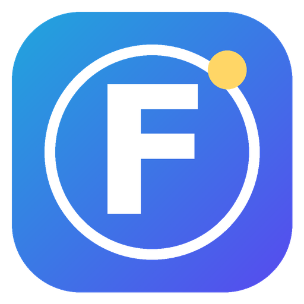

<p align="center"></p>

<h1 align="center">FreedomOS</h1>

<p align="center"><b>Your own little operating system on top of Windows.</b><br>
A local AI crew that works for you, a full-screen desktop with live wallpapers, its own browser,<br>
music app, Discord overlay, AI picture maker and file sync between all your PCs and your phone.</p>

<p align="center"><a href="../../releases/latest"><b>⬇ Download the installer</b></a> ·
<a href="docs/SETUP.md">📖 Setup guide (every feature)</a> ·
<a href="docs/TAILSCALE.md">🔒 Tailscale guide</a> ·
<a href="CREDITS.md">🙏 Credits</a></p>

---

## What it does

| | Feature | In plain words |
|---|---|---|
| 👥 | **The crew** | A team of AI agents that runs **on your own PC**: a planner, workers that work at the same time, and a checker that grades every piece. Give them a job, they split it up and hand back one clean answer. |
| 🧠 | **The brain** | A local language model (llama.cpp). Works with NVIDIA cards (fast) or Intel/AMD graphics. Switch it off to keep the PC cool - it wakes up by itself when you ask something. |
| ⚡ | **Quick Ask** | Ask a quick question (a spec, a number, an error code) - it searches the web, reads the pages and gives you **just the answer**, plus a crew double-check vote. |
| 🖥 | **Desktop mode** | FreedomOS lives full screen behind all your apps like a wallpaper, with a top bar that slides away. Win+D, the tray icon or the Copilot key brings it back. Games black it out so it never slows them down. |
| 🌐 | **WiBro** | Its own browser (Edge engine) with tabs you can tear off and drag back, bookmarks, a built-in ad blocker and Windows 11 style snap layouts *inside* the window. |
| 🎧 | **WiMix** | YouTube Music as an app tab: music video behind it, karaoke lyrics, a now-playing card. |
| 👾 | **Discord** | Discord as an app tab, a ping badge, and a game-style overlay (voice, chat, notifications) on top of everything. |
| 🎨 | **Pixel Shop** | Make AI pictures on your own PC (FLUX.2 klein / Z-Image on NVIDIA; Pixel Shop Lite runs without NVIDIA). Teach it your own art style. |
| 💬 | **Claude chat** | A chat window straight to Claude (through Claude Code, on your own Claude plan) with camera pictures. Claude desktop can also hand jobs to your crew. |
| 📁 | **Files** | The same files on all your PCs, plus send/browse from your phone. |
| 📱 | **Phone app** | With Tailscale, open FreedomOS on your phone (installable as an app) from anywhere - privately, never on the open internet. |

## Install (5 minutes of clicking, then it downloads by itself)

1. Download **`FreedomOS-Setup-x.y.z.exe`** from the [latest release](../../releases/latest).
2. Run it. Windows may say *"Windows protected your PC"* (the installer isn't code-signed) → **More info → Run anyway**.
3. Leave **"Finish setup and start FreedomOS"** ticked. A setup window installs Python and the brain engine and asks a few yes/no questions (Pixel Shop, Tailscale, Claude Code).
4. FreedomOS opens full screen. Your first question or job downloads the brain (about 6 GB) - watch the 🧠 line.

Needs **Windows 10 (1809+) or Windows 11, 64-bit**, about **15 GB free disk**, **16 GB RAM** (32 GB recommended). An NVIDIA card is optional but makes everything much faster.

👉 **The full walkthrough for every button is in [docs/SETUP.md](docs/SETUP.md).**

## Building it yourself

The installer is built by GitHub Actions ([`.github/workflows/build.yml`](.github/workflows/build.yml)) on every push, and every push to `main` publishes it as the release named after `version` in `app/config.json` (bump the version for a new release). To build on your own Windows PC:

```bat
dotnet publish app\browser\src\FreedomOS.csproj -c Release -r win-x64 --self-contained true -o app\browser\builds\b0
python installer\stamp_build.py
"C:\Program Files (x86)\Inno Setup 6\ISCC.exe" installer\FreedomOS.iss
```

The installer lands in `dist\`.

## Repo layout

```
app/                 everything that gets installed (to %LOCALAPPDATA%\FreedomOS)
  boss.py            the FreedomOS server: crew, brain, quick ask, jobs, phone access
  widget/            the Home screen (index.html, crew.js) + live wallpapers (walls/)
  browser/src/       WiBro, the FreedomOS app window (C# / WinForms / WebView2)
  pixelshop/         the Pixel Shop picture maker (NVIDIA)
  f35music.py        WiMix   ·   f35discord.py  Discord overlay   ·   f35web.py  search + WiBro control
  filesync.py        📁 file sync   ·   claudechat.py  💬 Claude chat   ·   mcp_bridge.py  Claude desktop plug-in
  FreedomOS Setup.cmd  first-run setup / repair      FreedomOS.cmd  the launcher
installer/           Inno Setup script + build stamp
docs/                setup + Tailscale guides
```

## Credits

FreedomOS was dreamed up by **[MatsuYoda-88](https://github.com/MatsuYoda-88)** and built together with **Claude** (Anthropic). It stands on a lot of great open-source work - see **[CREDITS.md](CREDITS.md)** for everyone who deserves a thank-you.

## License

FreedomOS's own code is under the **[MIT License](LICENSE)** - use it, change it, share it, just keep the copyright notice.
The AI models, tools and services it downloads or opens each have their own licenses and terms - see [CREDITS.md](CREDITS.md).
